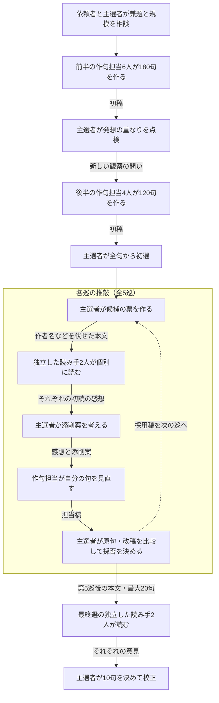
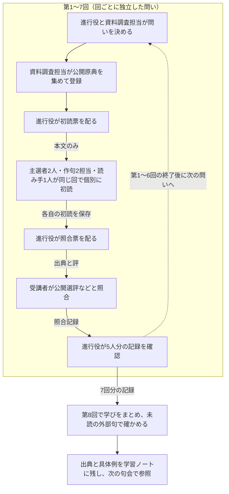

# 俳句工房

一つの兼題で俳句を作る**句会**と、外部の作品・添削・選評から学ぶ**勉強会**を行う、Codex用の工房です。作句、読解、添削、選句をAIエージェントが分担します。Pythonの補助コマンドで句数と音数を確認し、選句票と記録を作ります。

[句会の流れ](#句会) · [勉強会の流れ](#勉強会) · [手元の記録](#手元の記録)

## 句会

兼題（お題）と実施規模を相談してから始めます。本番では前半6人・後半4人が計300句を作ります。初選を経て、5巡の候補上限を **60 → 50 → 40 → 30 → 20句** とし、主選者が最後の10句を決めます。

| 役割 | 担当すること | 手本・参照先 |
| --- | --- | --- |
| **主選者（メイン）** | 配題、初選、添削、稿の比較、最終決定。発想の重なり、季語の働き、描写、切れと調べを読む | 夏井いつきさんの公開添削・選評を軸に、兼題に合う公開資料を参照 |
| **作句担当** | 担当する観察から独立に作句し、各巡で自分の稿を見直す | 芭蕉・蕪村・一茶・正岡子規・高浜虚子などの作品・俳論。兼題に合う歳時記や例句も参照 |
| **独立した読み手（各巡・最終選）** | 2人が別々に句面を読み、感想を主選者に返す。最終選では推す句も伝えられる | 票にある句面から得た各自の読み |

公開資料のリンクや五巡の具体的な手順は[運用手順](運用手順.md)にあります。

### 句会を始める

macOSまたはLinuxでPython 3を用意し、このフォルダをCodexで開きます。Python 3.13で動作を確認しています。

> 兼題は「冬の月」です。まず試行と本番の違いを説明し、進め方を相談してください。私が開始を伝えたら、決めた設定で句会を始めてください。

| 設定 | 初稿 | 推敲 | 最終選 |
| --- | ---: | ---: | ---: |
| `standard` | 10人で300句 | 5巡 | 10句 |
| `rehearsal` | 5人で30句 | 5巡 | 3句 |
| `pilot` | 5人で10句 | 1巡 | 2句 |

## 勉強会

1セットは8回、初読・照合・記録は受講者1人あたり1回15分が目安です。第1〜7回はそれぞれ独立した問いを扱い、各回の開始時に外部教材を選びます。第8回では7回分の学びをまとめ、未読の句で確かめます。

| 役割 | 担当すること | 手本・参照先 |
| --- | --- | --- |
| **進行役** | 資料調査担当と問いを決め、教材を配布し、記録が揃ったか確認する | 問いに応じて選んだ公開資料 |
| **資料調査担当** | 外部の句・添削・選評を探し、公開原典と既読状況を確認して登録する | 句集、俳句ポスト365、お〜いお茶新俳句大賞、プレバト!!など |
| **主選者A（メイン）** | 類想や採否を判断する根拠を探す | 夏井いつきさん・家藤正人さんの公開添削・選評 |
| **主選者B** | 別の読みを検討し、原句と改稿で変わる効果を比べる | Aと共通して夏井いつきさん・家藤正人さんの資料を参照 |
| **作句担当（古典・伝統）** | 季語、写生、取り合わせ、切れの働きを学ぶ | 芭蕉・蕪村・一茶・正岡子規・高浜虚子など |
| **作句担当（現代・多様な形式）** | 口語、比喩、語順、無季・自由律などを学ぶ | 正木ゆう子さんらの現代俳句、公募の入選句、尾崎放哉の自由律など |
| **独立した読み手** | 句面を自由に読み、初読を保存してから公開評と照らし合わせる | 片山由美子さん・髙柳克弘さん・神野紗希さん・堀田季何さんらの公開選句・選評 |

### 勉強会を始める

> 勉強会を1セット考えています。まず役割と各回の進め方を説明し、重点的に学びたいことや途中報告について相談してください。私が開始を伝えたら、合意した内容で始めてください。

教材の登録・配布、参照資料へのリンク、保存済みの回の再開方法は[勉強会の手順](reference/10_長時間学習の進め方.md)にあります。

## 手元の記録

通常、作句回は `runs/`、勉強会は `studies/`、付属手順のZIPは `exports/` に保存します。作句回の保存先は `atelier.py start` の `--runs-dir`、勉強会は `study.py` の `--studies-dir` で指定できます。既存の記録から再開する際は、保存した回の識別名かフォルダを指定します。個別の学習ノートは指定された手元の保存先に置き、指定がなければ `local/` を使います。

## システムを更新する

[作句の設定](profiles.json)と[勉強会の計画](study-plan.json)は新しい回の開始時にコピーします。手順や設定を変えたときは、同じ兼題と設定で試行し、出所を伏せて読み比べます。景の明瞭さ、類想の重なり、読み返したくなる語を比べ、採用する変更を記録します。

紹介した俳人・選者の作品や評は学習のための公開資料です。この工房での作句・添削・選評は、工房のAIエージェントが担当します。
